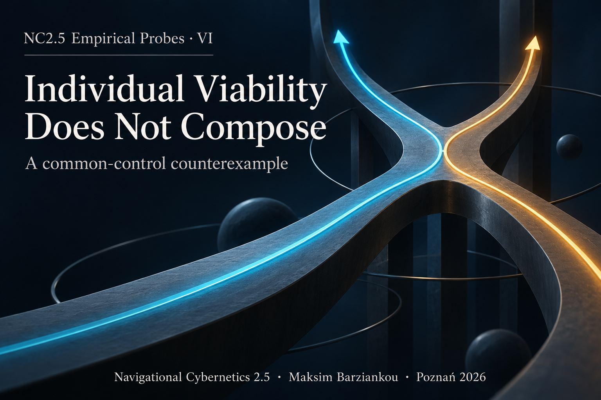

# Individual Viability Does Not Compose



**A common-control counterexample to $\mathcal{A}=\bigcap_i\mathcal{A}_i$**  
NC2.5 Empirical Probes — Part VI  
Maksim Barziankou (MxBv) · The Urgrund Laboratheory · Navigational Cybernetics 2.5  
Paper: [DOI 10.17605/OSF.IO/WFBX6](https://doi.org/10.17605/OSF.IO/WFBX6)  
License: CC BY-NC-ND 4.0 (manuscript and cover) · MIT (harness code)  

Being able to stay inside each constraint separately is not the same as being able to stay inside all of them at once. This work shows that the gap is real for a recent construction of admissible sets for linear systems, gives an exact three-state counterexample, and ships an executable certificate that checks it in exact rational arithmetic.

This repository holds the signed release: the manuscript, the protected PDF, the certificate with its tests, the archived source article, and a detached signature for every file of the release. This README is the repository's front page and is not part of the signed release.

## Scope and limits

The construction examined is Lévine, Rumschinski, Rußwurm and Streif, *Polytopic Inner Approximation of Admissible Sets for Linear Systems*, [arXiv:2607.29664v2](https://arxiv.org/abs/2607.29664v2). The scope is narrow:

- **L1.** The counterexample refutes the universal decomposition and the global innerness inference built on it.
- **L2.** It does not show that either numerical example in the source is wrong.
- **L3.** It does not invalidate the individual-set convexity result or the individual convex-hull inclusion.
- **L4.** It does not challenge the convexity of the global admissible set; Section 5.1 of the paper proves that conclusion directly.
- **L5.** It is not an `Adm_t` membership coding under Probe II. The source's control-theoretic admissible set and the NC2.5 candidate architecture class `Adm_t` are distinct objects.

No new classification instrument is introduced. The analysis uses the source's own definitions and asks only whether the same witness survives the passage from individual to joint admissibility.

## The result

The construction replaces one joint controlled-invariance problem by separate single-constraint problems and then intersects their results. Its decisive identity

$$\mathcal{A}=\bigcap_{i=1}^{p}\mathcal{A}_i$$

is false in general. The global admissible set requires one control function that satisfies every state constraint simultaneously; membership in every individual admissible set permits a different control function for each constraint. The missing step is a common-witness condition.

## The counterexample

Three states, one input $u\in[-1,1]$, two constraints $x_1\le 0$ and $x_2\le 0$:

$$\dot x_1=x_3+u,\qquad \dot x_2=x_3-u,\qquad \dot x_3=0.$$

The system satisfies the source's stated assumptions (A1) and (A2). Each constraint alone can be held whenever $x_3\le 1$: constraint 1 with $u\equiv-1$, constraint 2 with $u\equiv+1$. Together they cannot, because for every control

$$\frac{d}{dt}(x_1+x_2)=2x_3 .$$

So the exact sets are

$$\mathcal{A}_1\cap\mathcal{A}_2=\{x_1\le0,\ x_2\le0,\ x_3\le1\},\qquad \mathcal{A}=\{x_1\le0,\ x_2\le0,\ x_3\le0\},$$

and the slab $0<x_3\le 1$ is a false-positive region of the individual intersection. The sharp witness is $x^\star=(0,0,1)$: it lies in both individual admissible sets, and in both individual ultimate-tangentiality sets, so the individual sampling stage can retain it on both sides; yet no single control keeps it admissible, since $x_1(t)+x_2(t)=2t>0$ for $t>0$. Intersecting the individual inner approximations is therefore not, without an additional shared-control argument, a certified inner approximation of the global admissible set.

The paper also shows what survives and how the construction can be repaired (Section 5).

## Run the certificate

Python 3.10 or newer, standard library only, no network.

```sh
python harness/probe_vi.py
python -m unittest discover -s harness -p "test_*.py"
```

The first command prints a deterministic JSON certificate with six named checks and result `PASS`. The second runs seven tests: every numbered check has a targeted model mutation that must make it fail before any later check, and further mutations, models with a shared control, and helper tests cover the remaining conditions. `harness/certificate.json` records the unmodified certificate; `harness/README.md` describes each check.

## Verify the release

Every file of the signed release carries a detached GPG signature (`*.sig`); this README does not, since it is not part of the release. `SHA256SUMS` and `PROBE-VI.md` also carry OpenTimestamps proofs (`*.ots`). From the repository root:

```sh
gpg --import PETRONUS-Research-public-key.asc
gpg --fingerprint 9E803F8037EE98E5846CE38B0C7F9CBB6D54185D
gpg --verify SHA256SUMS.sig SHA256SUMS
sha256sum -c SHA256SUMS
gpg --verify "Individual Viability Does Not Compose (2026).pdf.sig" "Individual Viability Does Not Compose (2026).pdf"
gpg --verify PROBE-VI.md.sig PROBE-VI.md
ots verify SHA256SUMS.ots
```

Expected signing identity: `PETRONUS Research <research@petronus.eu>`, primary key fingerprint `9E80 3F80 37EE 98E5 846C E38B 0C7F 9CBB 6D54 185D`. Check the fingerprint against an independently trusted author record before trusting the key. A newly issued timestamp may carry only calendar attestations until it is upgraded and its Bitcoin commitment is confirmed. `VERIFY.txt` gives the full procedure, including the coverage check of the publication archive.

## Contents

| Path | What it is |
| --- | --- |
| `PROBE-VI.md` | The manuscript (Markdown with LaTeX) |
| `Individual Viability Does Not Compose (2026).pdf` | The protected PDF of the paper |
| `harness/` | The executable certificate, its tests, the recorded certificate, the optional PDF builder |
| `evidence/source/` | The examined arXiv article (HTML and PDF), unmodified, with its provenance record and digests |
| `Probe-VI-publication.zip` | The complete publication archive: manuscript, PDF, harness, source article, licences and key, without signatures |
| `Probe-VI-harness.zip` | The stand-alone stdlib companion |
| `SHA256SUMS` | Digests of the publication archive and every payload file |
| `VERIFY.txt` | Verification instructions |
| `PETRONUS-Research-public-key.asc` | The signing public key |
| `cover.png` | Cover |
| `LICENSE` | Licences |

## Cite

Maksim Barziankou (MxBv). *Individual Viability Does Not Compose: A Common-Control Counterexample.* NC2.5 Empirical Probes — Part VI. The Urgrund Laboratheory, 2026. [doi:10.17605/OSF.IO/WFBX6](https://doi.org/10.17605/OSF.IO/WFBX6)

## License

The manuscript and cover: [Creative Commons Attribution-NonCommercial-NoDerivatives 4.0 International](https://creativecommons.org/licenses/by-nc-nd/4.0/) — MxBv. The Python files under `harness/`: MIT, see `harness/LICENSE`. The archived source article keeps its own authorship and its CC BY-NC-ND 4.0 licence; it is redistributed unmodified.

[NC2.5 v2.1 Axiomatic Core](https://doi.org/10.17605/OSF.IO/NHTC5) · [Probe II](https://doi.org/10.17605/OSF.IO/7SQMY)
